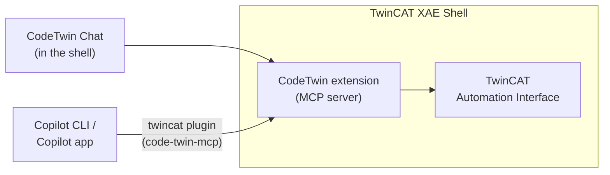

<h1 align="center">
  <picture>
    <source media="(prefers-color-scheme: dark)" srcset="assets/codetwin-logo-dark.svg">
    
  </picture>
</h1>

AI engineering for TwinCAT: AI agents read, edit and build your TwinCAT PLC code in TwinCAT XAE Shell.

## How it works

- The **CodeTwin extension** runs inside TwinCAT XAE Shell and gives AI agents tools to list, read, write, create and build PLC elements.
- The **chat** inside the shell talks to it directly.
- **Copilot CLI** and the **Copilot app** reach it through the `twincat` plugin. The plugin finds the shell that has your project open, or starts one.
- The AI runs on your own GitHub Copilot subscription. CodeTwin never touches your credentials.

## Install

You need Windows x64, TwinCAT XAE Shell (TwinCAT 3.1.4026), the [.NET 10 Runtime](https://dotnet.microsoft.com/download/dotnet/10.0) and [Copilot CLI](https://docs.github.com/copilot/how-tos/copilot-cli).

1. Close TwinCAT XAE Shell.
2. Run `CodeTwin-Setup-<version>.exe` from the [releases](https://github.com/Rouben94/code-twin/releases). No admin rights needed.

To update, run a newer setup. To uninstall, use **Settings > Apps**.

## Use

  <picture>
    <source media="(prefers-color-scheme: dark)" srcset="assets/chat-dark.png">
    
  </picture>

- **In the shell:** open your solution, then **Tools > CodeTwin > Chat**.
- **In Copilot CLI:** run `copilot --agent twincat:twincat` in your project folder.
- **In the Copilot app:** open your project folder and ask it to follow the `twincat` agent.

Then just ask, for example:

- `Implement F_Add with two INT inputs and call it from MAIN, then build and fix all errors.`
- `Write TcUnit tests for FB_Valve.`
- `What does compiler error C0077 mean?`

More details, and how to build CodeTwin: [docs/development.md](docs/development.md).

## What is supported

Supported today:

- Listing, searching and reading PLC elements
- Changing Structured Text code (declaration and implementation)
- Creating folders, programs, function blocks, functions, methods, properties, structs, enums and GVLs
- Building the solution and fixing compiler errors and warnings
- Writing TcUnit tests (running them is up to you)
- Several solutions or repositories open at the same time, each in its own shell
- Clients: CodeTwin Chat, Copilot CLI and the Copilot app
- TwinCAT 3.1.4026

Not supported yet:

- Deleting, renaming or moving PLC elements
- Creating interfaces, unions and aliases
- Graphical languages (FBD, LD, SFC, CFC)
- Visualizations (TwinCAT HMI, PLC visualizations, web visu)
- I/O tree, devices and EtherCAT configuration
- Motion (NC axes) and TwinCAT Safety configuration
- Adding or changing library references
- Activating the configuration, logging in, downloading and online changes
- Running TcUnit tests
- Clients: Claude Code, VS Code, Cursor, Codex CLI and Claude Desktop
- TwinCAT 3.1.4024

More is coming, and this list is updated as features are added.

Licensed under [MPL-2.0](LICENSE).
