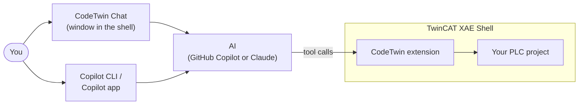
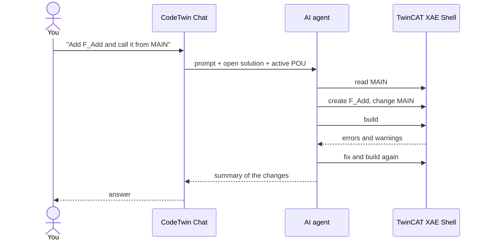

# CodeTwin Overview

CodeTwin lets an AI agent work on your TwinCAT PLC project the way you would: it reads the code, changes it, builds the project and fixes the errors. Everything happens in your own TwinCAT XAE Shell, on your own AI subscription.

## The parts



- **CodeTwin extension**: runs inside TwinCAT XAE Shell and gives the AI tools to list, read, write, create, rename, delete and build PLC elements.
- **CodeTwin Chat**: a chat window in the shell (**Tools > CodeTwin > Chat**). It already knows which solution is open and which POU you are looking at.
- **`twincat` agent and skills**: the TwinCAT know-how the AI follows: naming, Structured Text, OOP, data types, compiler errors, TcUnit, motion, and a live Beckhoff InfoSys search.
- **Copilot CLI / Copilot app**: can use the same tools from outside the shell through the `twincat` plugin. The plugin finds the shell that has your project open, or starts one.

## What happens when you ask something



The changes appear in the open editors right away; nothing is activated or downloaded to a PLC.

## You stay in control

- Reading the project and using the CodeTwin tools runs without asking. Anything else (shell commands, files outside the project, web access) asks first in the chat.
- **Plan** mode lets the agent propose a plan and wait for your approval before it changes anything.
- A **private chat** (lock button) is not saved.
- CodeTwin never sees your credentials. Copilot CLI or Claude Code handle the sign-in.

## Build from source

```powershell
dotnet build CodeTwin.slnx -c Release
tools\Install-TcXaeShell.ps1
```

The first command builds everything, the second installs the extension into TcXaeShell (close the shell first). `installer\Build-Setup.ps1` builds the full setup into `artifacts\` and needs [Inno Setup 6](https://jrsoftware.org/isinfo.php).
